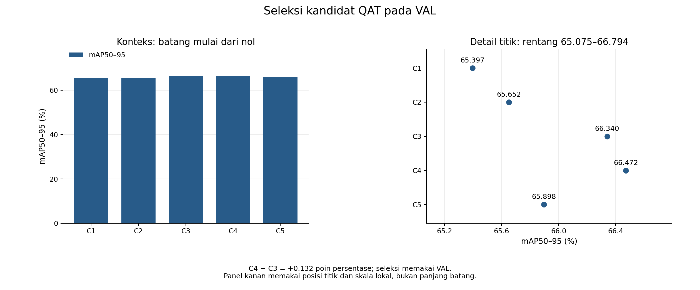
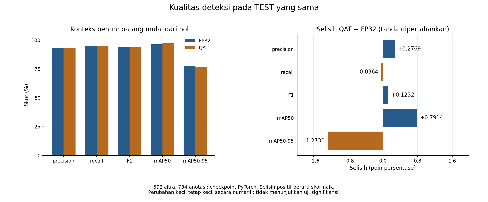
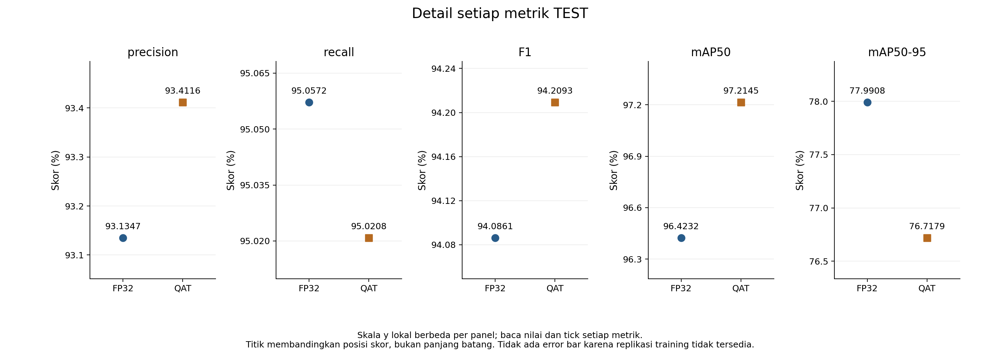

# Grafik hasil penelitian

Dibuat dari CSV/JSON beku, tanpa training, evaluasi ulang, atau pengukuran robot.

Batang absolut dimulai dari nol. Panel titik memakai skala lokal yang tertulis. Skor deteksi ditampilkan dalam persen; selisihnya dalam poin persentase. Perbaikan dan penurunan sama-sama ditampilkan. Ini pembesaran visual, bukan bukti signifikansi.

## Contoh utama

## Seluruh grafik dan sumber

| Grafik | Sumber |
| --- | --- |
| [qat_candidate_best](qat_candidate_best.png) | [artifacts/checkpoints/qat/selection_manifest.json](../../artifacts/checkpoints/qat/selection_manifest.json) |
| [qat_c1_loss](qat_c1_loss.png) | [artifacts/checkpoints/qat_search/qat_lr1e5_r128_e10/results.csv](../../artifacts/checkpoints/qat_search/qat_lr1e5_r128_e10/results.csv) |
| [qat_c1_metrics](qat_c1_metrics.png) | [artifacts/checkpoints/qat_search/qat_lr1e5_r128_e10/results.csv](../../artifacts/checkpoints/qat_search/qat_lr1e5_r128_e10/results.csv) |
| [qat_c2_loss](qat_c2_loss.png) | [artifacts/checkpoints/qat_search/qat_lr3e5_r128_e10/results.csv](../../artifacts/checkpoints/qat_search/qat_lr3e5_r128_e10/results.csv) |
| [qat_c2_metrics](qat_c2_metrics.png) | [artifacts/checkpoints/qat_search/qat_lr3e5_r128_e10/results.csv](../../artifacts/checkpoints/qat_search/qat_lr3e5_r128_e10/results.csv) |
| [qat_c3_loss](qat_c3_loss.png) | [artifacts/checkpoints/qat_search/qat_lr5e5_r256_e15/results.csv](../../artifacts/checkpoints/qat_search/qat_lr5e5_r256_e15/results.csv) |
| [qat_c3_metrics](qat_c3_metrics.png) | [artifacts/checkpoints/qat_search/qat_lr5e5_r256_e15/results.csv](../../artifacts/checkpoints/qat_search/qat_lr5e5_r256_e15/results.csv) |
| [qat_c4_loss](qat_c4_loss.png) | [artifacts/checkpoints/qat_search/qat_lr1e4_r256_e15/results.csv](../../artifacts/checkpoints/qat_search/qat_lr1e4_r256_e15/results.csv) |
| [qat_c4_metrics](qat_c4_metrics.png) | [artifacts/checkpoints/qat_search/qat_lr1e4_r256_e15/results.csv](../../artifacts/checkpoints/qat_search/qat_lr1e4_r256_e15/results.csv) |
| [qat_c5_loss](qat_c5_loss.png) | [artifacts/checkpoints/qat_search/qat_lr3e5_r512_e20/results.csv](../../artifacts/checkpoints/qat_search/qat_lr3e5_r512_e20/results.csv) |
| [qat_c5_metrics](qat_c5_metrics.png) | [artifacts/checkpoints/qat_search/qat_lr3e5_r512_e20/results.csv](../../artifacts/checkpoints/qat_search/qat_lr3e5_r512_e20/results.csv) |
| [qat_candidate_history](qat_candidate_history.png) | [artifacts/checkpoints/qat_search/qat_lr1e5_r128_e10/results.csv](../../artifacts/checkpoints/qat_search/qat_lr1e5_r128_e10/results.csv) [artifacts/checkpoints/qat_search/qat_lr3e5_r128_e10/results.csv](../../artifacts/checkpoints/qat_search/qat_lr3e5_r128_e10/results.csv) [artifacts/checkpoints/qat_search/qat_lr5e5_r256_e15/results.csv](../../artifacts/checkpoints/qat_search/qat_lr5e5_r256_e15/results.csv) [artifacts/checkpoints/qat_search/qat_lr1e4_r256_e15/results.csv](../../artifacts/checkpoints/qat_search/qat_lr1e4_r256_e15/results.csv) [artifacts/checkpoints/qat_search/qat_lr3e5_r512_e20/results.csv](../../artifacts/checkpoints/qat_search/qat_lr3e5_r512_e20/results.csv) |
| [fp32_loss](fp32_loss.png) | [experiments/fp32/fp32_baseline/results.csv](../../experiments/fp32/fp32_baseline/results.csv) |
| [fp32_metrics](fp32_metrics.png) | [experiments/fp32/fp32_baseline/results.csv](../../experiments/fp32/fp32_baseline/results.csv) |
| [fp32_metrics_last20](fp32_metrics_last20.png) | [experiments/fp32/fp32_baseline/results.csv](../../experiments/fp32/fp32_baseline/results.csv) |
| [test_overall_and_delta](test_overall_and_delta.png) | [experiments/final_test/fp32_test_metrics.json](../../experiments/final_test/fp32_test_metrics.json) [experiments/final_test/qat_test_metrics.json](../../experiments/final_test/qat_test_metrics.json) |
| [test_overall_focused](test_overall_focused.png) | [experiments/final_test/fp32_test_metrics.json](../../experiments/final_test/fp32_test_metrics.json) [experiments/final_test/qat_test_metrics.json](../../experiments/final_test/qat_test_metrics.json) |
| [test_class_precision](test_class_precision.png) | [experiments/final_test/fp32_test_metrics.json](../../experiments/final_test/fp32_test_metrics.json) [experiments/final_test/qat_test_metrics.json](../../experiments/final_test/qat_test_metrics.json) |
| [test_class_recall](test_class_recall.png) | [experiments/final_test/fp32_test_metrics.json](../../experiments/final_test/fp32_test_metrics.json) [experiments/final_test/qat_test_metrics.json](../../experiments/final_test/qat_test_metrics.json) |
| [test_class_F1](test_class_F1.png) | [experiments/final_test/fp32_test_metrics.json](../../experiments/final_test/fp32_test_metrics.json) [experiments/final_test/qat_test_metrics.json](../../experiments/final_test/qat_test_metrics.json) |
| [test_class_mAP50](test_class_mAP50.png) | [experiments/final_test/fp32_test_metrics.json](../../experiments/final_test/fp32_test_metrics.json) [experiments/final_test/qat_test_metrics.json](../../experiments/final_test/qat_test_metrics.json) |
| [test_class_mAP50_95](test_class_mAP50_95.png) | [experiments/final_test/fp32_test_metrics.json](../../experiments/final_test/fp32_test_metrics.json) [experiments/final_test/qat_test_metrics.json](../../experiments/final_test/qat_test_metrics.json) |
| [ros_inference_mean_ms](ros_inference_mean_ms.png) | [experiments/hardware_op3/operator_runs/20261019T132747Z_fp32_berjalan_final/analysis/ros_fp32_vs_qat_conditions.csv](../../experiments/hardware_op3/operator_runs/20261019T132747Z_fp32_berjalan_final/analysis/ros_fp32_vs_qat_conditions.csv) |
| [ros_inference_p95_ms](ros_inference_p95_ms.png) | [experiments/hardware_op3/operator_runs/20261019T132747Z_fp32_berjalan_final/analysis/ros_fp32_vs_qat_conditions.csv](../../experiments/hardware_op3/operator_runs/20261019T132747Z_fp32_berjalan_final/analysis/ros_fp32_vs_qat_conditions.csv) |
| [ros_pipeline_mean_ms](ros_pipeline_mean_ms.png) | [experiments/hardware_op3/operator_runs/20261019T132747Z_fp32_berjalan_final/analysis/ros_fp32_vs_qat_conditions.csv](../../experiments/hardware_op3/operator_runs/20261019T132747Z_fp32_berjalan_final/analysis/ros_fp32_vs_qat_conditions.csv) |
| [ros_effective_fps](ros_effective_fps.png) | [experiments/hardware_op3/operator_runs/20261019T132747Z_fp32_berjalan_final/analysis/ros_fp32_vs_qat_conditions.csv](../../experiments/hardware_op3/operator_runs/20261019T132747Z_fp32_berjalan_final/analysis/ros_fp32_vs_qat_conditions.csv) |
| [ros_process_cpu_percent_mean](ros_process_cpu_percent_mean.png) | [experiments/hardware_op3/operator_runs/20261019T132747Z_fp32_berjalan_final/analysis/ros_fp32_vs_qat_conditions.csv](../../experiments/hardware_op3/operator_runs/20261019T132747Z_fp32_berjalan_final/analysis/ros_fp32_vs_qat_conditions.csv) |
| [ros_system_cpu_percent_mean](ros_system_cpu_percent_mean.png) | [experiments/hardware_op3/operator_runs/20261019T132747Z_fp32_berjalan_final/analysis/ros_fp32_vs_qat_conditions.csv](../../experiments/hardware_op3/operator_runs/20261019T132747Z_fp32_berjalan_final/analysis/ros_fp32_vs_qat_conditions.csv) |
| [ros_detector_rss_mb_mean](ros_detector_rss_mb_mean.png) | [experiments/hardware_op3/operator_runs/20261019T132747Z_fp32_berjalan_final/analysis/ros_fp32_vs_qat_conditions.csv](../../experiments/hardware_op3/operator_runs/20261019T132747Z_fp32_berjalan_final/analysis/ros_fp32_vs_qat_conditions.csv) |
| [ros_system_ram_mb_mean](ros_system_ram_mb_mean.png) | [experiments/hardware_op3/operator_runs/20261019T132747Z_fp32_berjalan_final/analysis/ros_fp32_vs_qat_conditions.csv](../../experiments/hardware_op3/operator_runs/20261019T132747Z_fp32_berjalan_final/analysis/ros_fp32_vs_qat_conditions.csv) |
| [ros_runs_effective_fps](ros_runs_effective_fps.png) | [experiments/hardware_op3/operator_runs/20261019T132747Z_fp32_berjalan_final/analysis/per_run_recap.csv](../../experiments/hardware_op3/operator_runs/20261019T132747Z_fp32_berjalan_final/analysis/per_run_recap.csv) |
| [ros_runs_inference_mean_ms](ros_runs_inference_mean_ms.png) | [experiments/hardware_op3/operator_runs/20261019T132747Z_fp32_berjalan_final/analysis/per_run_recap.csv](../../experiments/hardware_op3/operator_runs/20261019T132747Z_fp32_berjalan_final/analysis/per_run_recap.csv) |
| [standalone_synthetic_inference_mean_ms](standalone_synthetic_inference_mean_ms.png) | [experiments/hardware_op3/comparison_models/20261007_four_models_run1/comparison_all.csv](../../experiments/hardware_op3/comparison_models/20261007_four_models_run1/comparison_all.csv) |
| [standalone_synthetic_effective_fps](standalone_synthetic_effective_fps.png) | [experiments/hardware_op3/comparison_models/20261007_four_models_run1/comparison_all.csv](../../experiments/hardware_op3/comparison_models/20261007_four_models_run1/comparison_all.csv) |
| [standalone_synthetic_process_cpu_mean_percent](standalone_synthetic_process_cpu_mean_percent.png) | [experiments/hardware_op3/comparison_models/20261007_four_models_run1/comparison_all.csv](../../experiments/hardware_op3/comparison_models/20261007_four_models_run1/comparison_all.csv) |
| [standalone_synthetic_rss_mean_mb](standalone_synthetic_rss_mean_mb.png) | [experiments/hardware_op3/comparison_models/20261007_four_models_run1/comparison_all.csv](../../experiments/hardware_op3/comparison_models/20261007_four_models_run1/comparison_all.csv) |
| [standalone_camera_inference_mean_ms](standalone_camera_inference_mean_ms.png) | [experiments/hardware_op3/comparison_models/20261007_four_models_run1/comparison_all.csv](../../experiments/hardware_op3/comparison_models/20261007_four_models_run1/comparison_all.csv) |
| [standalone_camera_effective_fps](standalone_camera_effective_fps.png) | [experiments/hardware_op3/comparison_models/20261007_four_models_run1/comparison_all.csv](../../experiments/hardware_op3/comparison_models/20261007_four_models_run1/comparison_all.csv) |
| [standalone_camera_process_cpu_mean_percent](standalone_camera_process_cpu_mean_percent.png) | [experiments/hardware_op3/comparison_models/20261007_four_models_run1/comparison_all.csv](../../experiments/hardware_op3/comparison_models/20261007_four_models_run1/comparison_all.csv) |
| [standalone_camera_rss_mean_mb](standalone_camera_rss_mean_mb.png) | [experiments/hardware_op3/comparison_models/20261007_four_models_run1/comparison_all.csv](../../experiments/hardware_op3/comparison_models/20261007_four_models_run1/comparison_all.csv) |
| [server_latency_distribution](server_latency_distribution.png) | [experiments/server_openvino/server_benchmark_fp32.csv](../../experiments/server_openvino/server_benchmark_fp32.csv) [experiments/server_openvino/server_benchmark_ptq_int8.csv](../../experiments/server_openvino/server_benchmark_ptq_int8.csv) [experiments/server_openvino/server_benchmark_qat_int8.csv](../../experiments/server_openvino/server_benchmark_qat_int8.csv) |
| [stability_latency](stability_latency.png) | [experiments/hardware_op3/stability_qat/20261007_ros_qat/latency/stability_run_01_frames.csv](../../experiments/hardware_op3/stability_qat/20261007_ros_qat/latency/stability_run_01_frames.csv) |
| [stability_resources](stability_resources.png) | [experiments/hardware_op3/stability_qat/20261007_ros_qat/resources/stability_run_01.csv](../../experiments/hardware_op3/stability_qat/20261007_ros_qat/resources/stability_run_01.csv) |

Lihat [alasan revisi dan cara menjalankan](../32_revisi_visualisasi_grafik.md).
