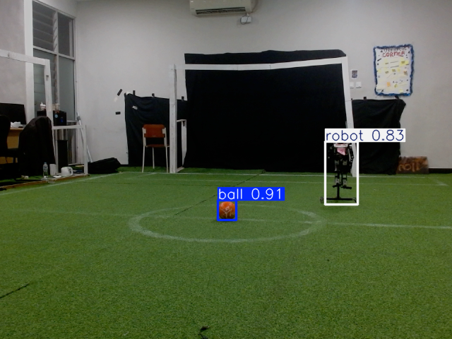
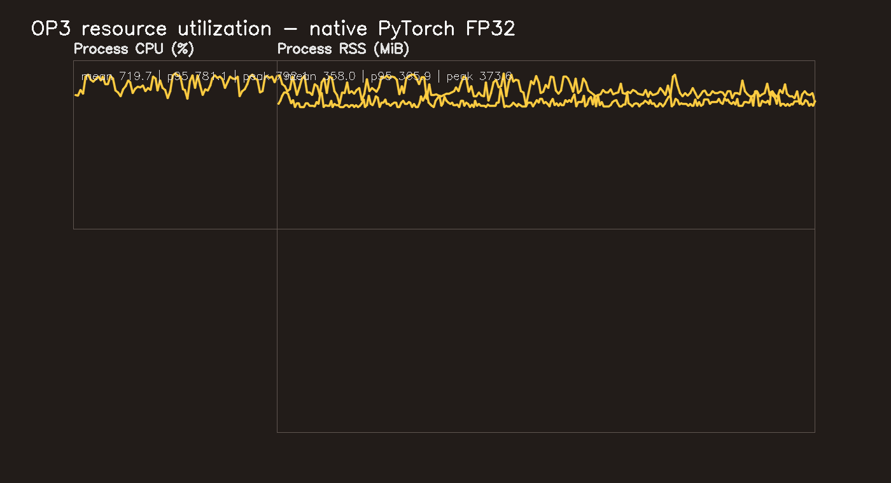
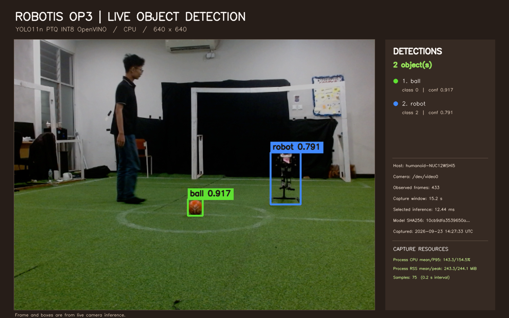
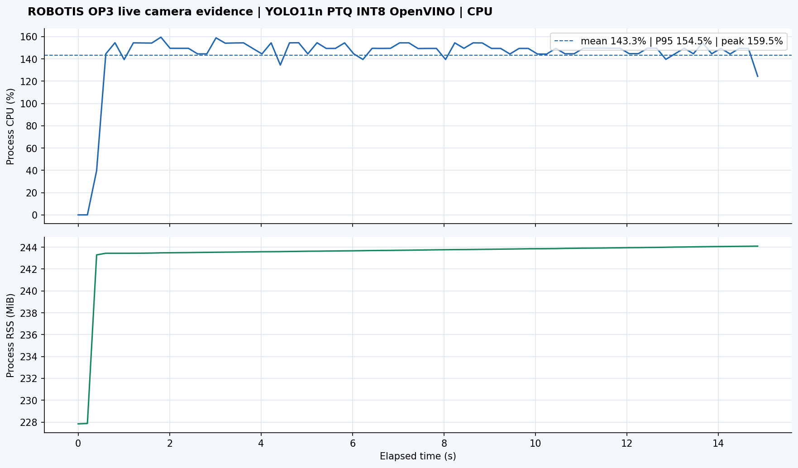
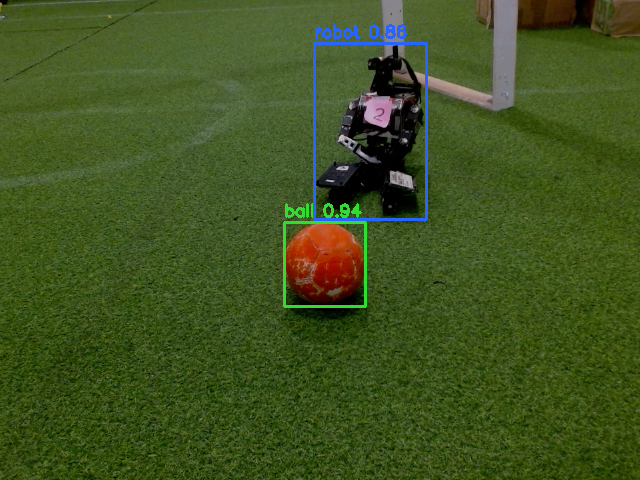
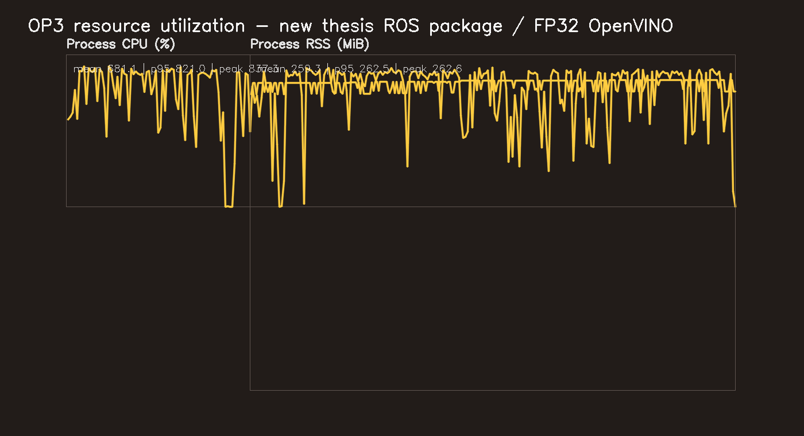

# OP3 Hardware Test Report

## Active deployment status (2026-10-07)

The user confirms that the models were trained and uploaded by the user and requests deployment according to the artifact folder labels without SHA256 checks. The runtime labels follow `artifacts/openvino/{fp32,ptq_int8,qat_int8}`. Payload identity and quantization provenance are not independently verified under this policy. Repository manifest evidence is reported separately from runtime results.

All three canonical model pairs passed CPU load, compile, and dummy-inference sanity checks with input `[1,3,640,640]`, output `[1,7,8400]`, and finite outputs. Actual records are in `openvino_sanity.json`. The test host is NUC12WSHi5; this is the hardware used for measurements and does not prevent deployment. SHA256 validation is absent from the current deployment scripts; the isolated ROS node no longer computes model hashes. Historical raw result files retain their original metadata.

The recorded user-labeled QAT camera run is a functional GUI run: 1,349 frames in 60.01 seconds, mean inference 12.33 ms, process CPU mean 124.16%, and peak RSS 263.00 MiB. Visualization was enabled. These observations are not an official visualization-off QAT benchmark or independent confirmation of the training method.

## Final stationary ROS measurements (2026-10-07)

Robot stationary and C920 attached, confirmed by operator. Three runs of 60 seconds used the user-designated `artifacts/openvino/qat_int8/model.xml` on CPU, model input 640×640, camera capture 640×480 YUYV, requested 30 Hz. Debug images and telemetry were OFF. Each run discarded 30 dummy inference warmups and 30 successful camera warmup frames. Resource sampling interval was 0.2 seconds.

The three completed runs processed 2,442 frames with zero callback exceptions. Pooled detection-ready latency was 17.9763 ms, and effective FPS was 13.5658 (successful frames divided by the sum of measured wall durations). Individual run FPS was 13.4826, 15.0655, and 12.1492. These are camera/ROS pipeline rates; they are not the reciprocal of inference latency.

Across 885 periodic resource samples, system CPU mean was 6.4163% (sample SD 1.5655%, peak 11.5%). System used RAM mean was 4,083.7804 MB (sample SD 8.3941 MB); memory usage percent mean was 56.5762%. Detector RSS mean/peak was 257.5252/257.8186 MB. MB uses decimal bytes/1,000,000. Process CPU is retained separately and can exceed 100% across cores. System metrics include background OS/ROS activity.

A separate synthetic engine run used 30 warmups and 300 iterations: inference mean 11.2795 ms, inference-derived FPS 88.6562, effective pipeline FPS 76.7968. This run excludes camera and ROS transport. Its raw files are `benchmark_qat_int8_engine_20261007.*` and `resources_benchmark_qat_int8_engine_20261007.csv`; its existing benchmark helper uses population SD, while the final ROS tables use sample SD (`ddof=1`).

Final protocol, environment snapshots, raw CSV, per-run metadata, generated tables, and report are in `final_qat/`. Resource evidence is `final_qat/evidence/resources_diam_run_01.png`. A missing `usb_cam` overlay caused an earlier startup failure; no measurements were produced by that attempt. The wrapper now sources both robot and isolated thesis overlays, and the runner detects camera failures early. Those logs were preserved.

Read-only camera inspection during stability found driver configuration 30 Hz, auto exposure enabled, and exposure_dynamic_framerate=1. This may contribute to the lower observed camera rate; it is an inference, not an isolated causal measurement. No controls were changed. See final_qat/camera_controls_observed.json.

Walking has been explicitly deferred by the operator. The same-protocol walking script is ready and sends no motion commands. No walking data or comparison delta has been invented. Dataset accuracy remains the frozen native-PyTorch result in `experiments/final_test/`; it is not an accuracy evaluation of these live-camera IR measurements.

## ROS QAT-folder stability (2026-10-07)

A real C920 stationary run completed 600.0162 seconds, processing 8,260 frames with zero exceptions. Effective FPS was 13.7663; detection-ready latency mean was 17.6222 ms. System CPU mean/peak was 6.3661%/16.9%; detector process CPU mean/peak was 88.2798%/163.6%. RSS before/after the window was 257,945,600/258,379,776 bytes, growth 434,176 bytes, measured before allocating the CSV summary. The maximum observed thermal-zone temperature was 59 C. These data show limited RSS growth during this run; they do not conclusively prove absence of a memory leak. Camera dropped frames remain unknown.

Raw frame/resource CSV, per-run metadata, plot and stability report are in `stability_qat/20261007_ros_qat/`. Walking measurements remain deferred by the user. The runner does not control motion.

## Functional ROS evidence (2026-10-07)

A separate debug-enabled run verified actual publication/subscription: 122 detection messages, 122 telemetry messages, and 3 debug images were received by an independent ROS subscriber. The functional run processed 92 measured frames with zero exceptions; it is excluded from the official tables because rendering/telemetry were enabled. Topic evidence is `functional_qat/20261007_topic_check/topic_verification.json`. The actual annotated C920 image is `functional_qat/20261007_topic_check/functional_run_01_detection.png`. This screenshot verifies rendering, not correctness against ground truth.

## Repository update (2026-10-07)

Local `main` was fast-forwarded to `origin/main` at `01af3977129b153adb1c4570a6be2a4551588ee0`. Local source changes, the isolated ROS package, and experiment evidence were preserved; a backup remains in stash `op3-local-before-origin-main-2026-10-07`. Deployment scripts now live under `scripts/deployment/`, and the visual runner was updated to that location. CLI import and shell syntax checks passed. This update did not run a new hardware experiment.

Git LFS payloads were materialized during the preceding session. The additional local `camera_benchmark_qat_int8.json` records a GUI-enabled run of the user-designated QAT path. Its label follows the user's model designation; the training method is not independently established for this run. Visualization was enabled, so this is a functional check rather than an official visualization-off benchmark. The sections below retain the earlier measurements and their historical context.

Updated 2026-09-30 after pulling `fix-banget` and adding an isolated thesis ROS 2 package. Earlier standalone, camera, and existing-node measurements remain historical runs; the new ROS package measurement below uses the current branch commit. The connected host is still NUC12, not the thesis target NUC11.

## Current branch and isolated ROS package update (2026-09-30)

The measurement-time commit was `43bb261cf2f70d0e4afe9d1e38077487f017c581`. Canonical OpenVINO locations are `artifacts/openvino/{fp32,ptq_int8,qat_int8}`. Before the subsequent Git LFS download these files were pointers. The local FP32 runtime copy was used for the package smoke and camera tests. Earlier PTQ hardware results used the separate `experiments/ptq` comparator.

The branch's QAT checkpoint selection and export manifests report accepted true-NNCF-QAT provenance, no PTQ/calibration, and 32/32 VAL equivalence passes. Current deployment uses the user-confirmed folder labels without payload identity checks. Earlier file identity observations are retained in historical raw metadata; they are not used as a deployment gate.

The new package lives in the separate `ros2_ws/src/yolo11_op3_vision` workspace, not in the robot's existing `src/` tree. Its Jazzy build passed. A real C920 test used `/thesis/image_raw` and published standard `vision_msgs/Detection2DArray` messages on `/vision/detections`; the debug image publisher was off. A 60-second run processed 1,379 frames with zero callback exceptions:

| Metric | Result |
| --- | ---: |
| Effective callback rate | 22.98 FPS |
| Inference mean / P95 | 31.59 / 50.26 ms |
| Callback end-to-end mean / P95 | 35.57 / 55.27 ms |
| Camera-header delivery mean / P95 | 97.54 / 147.02 ms |
| Process CPU mean / P95 / peak | 681.1% / 821.0% / 837.3% |
| Process RSS mean / peak | 259.35 / 262.55 MiB |
| Resource samples / detections / exceptions | 298 / 2,758 / 0 |

The run metadata and per-frame/per-sample data are in `ros2_benchmark_fp32_openvino_thesis_pkg.json`, `ros2_benchmark_fp32_openvino_thesis_pkg.csv`, and `resources_ros2_benchmark_fp32_openvino_thesis_pkg.csv`. Detection and resource evidence are in `evidence/live_detection_ros2_fp32_thesis_pkg.png` and `evidence/resource_utilization_ros2_benchmark_fp32_openvino_thesis_pkg.png`.

## 1. Hardware

The connected host is `humanoid-NUC12WSHi5`, with a 12th Gen Intel Core i5-1240P (12 cores, 16 logical CPUs), 7.33 GiB RAM, Ubuntu 24.04.5 LTS, and kernel 7.0.0-34-generic at the latest audit. CPU features include AVX, AVX2, and AVX-VNNI; AVX-512 is unavailable. The thesis target is Intel NUC11PAHi5, so this run does not establish NUC11 performance.

The Logitech HD Pro Webcam C920 is `/dev/video0` (640 x 480, YUYV); `/dev/video1` is the second enumerated interface and was not selected. Camera observations have no ground truth.

## 2. Software

| Component | Observed |
| --- | --- |
| ROS 2 | Jazzy; workspace camera and detector launch succeeded |
| OpenVINO | 2026.3.1; CPU device compiled and inferred successfully |
| Native inference | Python 3.12.3, PyTorch 2.4.1+cpu, torchvision 0.19.1+cpu, Ultralytics 8.4.130 |
| Native inference support | NumPy 1.26.4, OpenCV 4.6.0, psutil; no OpenVINO in the native PyTorch run |
| Camera | C920 `/dev/video0`, V4L2/OpenCV and ROS `usb_cam` |
| Input / batch | 640 x 640 model input, batch 1, CPU only |

The repository's main project metadata pins Python below 3.12 and OpenVINO 2024.4. The connected ROS runtime is Python 3.12.3 / OpenVINO 2026.3.1. The native PyTorch CPU packages were installed into the ignored `.cache/hardware_models/pytorch_venv`; the system NumPy/OpenCV/psutil packages were reused. No system package or model training was changed. No NVIDIA device was used.

## 3. Model provenance

The class map in every audited model is `0: ball`, `1: gawang`, `2: robot`.

| Model | Artifact and SHA256 | Provenance / disposition |
| --- | --- | --- |
| YOLO11n FP32 native PyTorch | `artifacts/checkpoints/fp32/best.pt`, 5,481,875 bytes; `e05b2b21f7faa68f65671f0aaae37ad962aa5e25c6b8b26853fd0b389d420b8c` | Frozen checkpoint; LFS OID, completed manifest, class map, and export provenance agree. Loaded directly with Ultralytics on CPU; no OpenVINO conversion in this run. |
| YOLO11n FP32 OpenVINO | XML `233bb872e218ab3bf525188b0e105eea9f2a79e60ffecb4b767e63939ba257e7`; BIN `e85f45438b5f7c8858b1a168a03f61b12a73b8159391529d19b84e09ff854026` | Previously audited export of the frozen FP32 checkpoint; valid comparator. |
| YOLO11n PTQ INT8 OpenVINO | XML `10cb9dfa3539650a0bc46d60ad708f9ff79fc1e2dc79c5ac4a73ff4943326657`; BIN `82246726edcd780685657f673caa2b40719a8c22b67e3702ca3d1f226b8fcf81` | Existing artifact only. Manifest records `quantize=8` with a calibration dataset, no QAT checkpoint/training, and no TEST split. XML/BIN hash and size match the manifest and the repository labels it `VALID comparator`. No new PTQ export or calibration was performed for these hardware runs. |
| User-supplied QAT OpenVINO INT8 | `artifacts/openvino/qat_int8/model.xml` + `.bin` | CPU runtime sanity passed. QAT label is supplied by the user; payload identity is not independently verified. Repository export manifests report accepted numerical evidence. |

The branch export/selection evidence and model inventory are recorded in `model_inventory.json`. The OpenVINO runner refuses model files that are still unresolved LFS pointers; manifest acceptance alone is not treated as a hardware result.

## 4. Experimental setup

Standalone synthetic tests used 30 warmups and 300 measured iterations. Each direct-camera run used 30 warmups and a 60-second timed window. ROS 2 comparator runs used 30 warmup callbacks and a 60-second window. Resource samples were taken approximately every 0.2 seconds. Model load, OpenVINO compile, warmups, and evidence rendering are excluded from timed measurements. Camera dropped frames are not directly countable through the selected V4L2/OpenCV interface; ROS drop counts are estimates from configured 30 FPS.

Process CPU is aggregate across cores: 100% means one logical core, so values above 100% represent multicore use. Raw per-iteration and resource CSVs are retained. The additional runs were measured at repository HEAD `33b0b3b5ac395497e111bccdbec1d4eef0c5346e` with the benchmark additions present as uncommitted source at measurement time; source scripts and their measurement-time SHA256 values are identified in the JSON outputs. The source changes are included in the final commit.

## 5. Standalone synthetic benchmark

| Model | Mean inference / P95 (ms) | Mean pipeline / loop (ms) | Inference FPS | Effective FPS | Process CPU mean / P95 | RSS mean / peak (MiB) |
| --- | ---: | ---: | ---: | ---: | ---: | ---: |
| FP32 OpenVINO | 28.491 / 30.350 | 30.504 | 35.10 | 32.77 | 873.5% / 901.3% | 227.5 / 227.6 |
| FP32 native PyTorch (no OpenVINO) | 49.484 / 53.527 | 51.651 | 20.21 | 19.35 | 800.2% / 804.8% | 360.6 / 377.2 |
| Existing PTQ INT8 OpenVINO | 11.276 / 11.616 | 13.041 | 88.69 | 76.60 | 340.4% / 343.8% | 215.9 / 216.0 |

The pipeline column is mean measured loop wall time for each engine. OpenVINO stage sums are also retained in each JSON file; they differ from loop wall time by small host/script overhead. FPS is computed from 300 completed iterations and is kept separate from the inverse mean inference latency. Outputs were finite and all three class IDs were checked against the expected mapping. Raw measurements: `benchmark_fp32.csv`, `benchmark_fp32_pytorch.csv`, and `benchmark_ptq_int8.csv`; resource CSVs use the corresponding `resources_*.csv` names.

## 6. Camera benchmark

| Model | Frames / duration | Mean inference / P95 (ms) | Mean pipeline wall (ms) | Inference FPS | Effective FPS | Process CPU mean / P95 | RSS mean / peak (MiB) |
| --- | ---: | ---: | ---: | ---: | ---: | ---: | ---: |
| FP32 OpenVINO | 1,273 / 60.04 s | 37.067 / 60.078 | 47.145 | 26.98 | 21.20 | 716.2% / 818.2% | 229.1 / 229.8 |
| FP32 native PyTorch (no OpenVINO) | 1,195 / 60.01 s | 39.502 / 44.674 | 50.179 | 25.32 | 19.91 | 719.7% / 781.1% | 358.0 / 373.6 |
| Existing PTQ INT8 OpenVINO | 1,442 / 60.01 s | 12.377 / 15.076 | 41.597 | 80.79 | 24.03 | 128.4% / 154.2% | 217.8 / 218.5 |

The direct-camera FPS is completed frames divided by the actual timed window. The V4L2 path has no source sequence counter, so dropped frames are unknown. Live detections are functional observations only and are not precision/recall measurements.

## 7. ROS 2 benchmark

The earlier Jazzy `usb_cam` + `yolo11_openvino_node` launch was run with debug image publication disabled, CPU device, and the same C920. Those measurements are historical; they used the earlier FP32 cache and `experiments/ptq` comparator paths. A separate thesis package was then built and tested as described in the current-branch update above.

| Model | Frames / duration | Mean inference / P95 (ms) | Callback latency mean / P95 (ms) | Effective FPS | Process CPU mean / P95 | RSS mean / peak (MiB) | Exceptions |
| --- | ---: | ---: | ---: | ---: | ---: | ---: | ---: |
| FP32 OpenVINO | 1,454 / 60.03 s | 31.234 / 54.827 | 33.828 / 59.505 | 24.22 | 705.1% / 863.9% | 262.2 / 262.2 | 0 |
| Existing PTQ INT8 OpenVINO | 776 / 60.01 s | 11.865 / 12.971 | 16.718 / 19.823 | 12.93 | 75.4% / 158.8% | 241.5 / 249.1 | 0 |

The PTQ callback run observed an estimated 1,024 fewer callbacks than `30 FPS x 60 s`; that figure is an estimate, not camera-side ground truth. Image timestamps had a 36.0 ms median gap and a 77.2 ms mean gap, with a 236 ms P95 gap. Therefore the PTQ ROS throughput is reported as observed and should not be inferred from the 11.9 ms model inference time alone. The camera-to-node path and DDS scheduling limited completed callbacks in this run. Native PyTorch was benchmarked standalone with the live camera; the existing ROS detector node accepts OpenVINO IR, so no native PyTorch ROS node was added.

The isolated package's current-branch FP32 row uses `/vision/detections` and records the complete callback path. Its raw timing and resource CSV files are retained alongside the JSON summary.

## 8. CPU utilization

CPU was sampled throughout each run, not read once. The synthetic native PyTorch benchmark averaged 800.2% process CPU and the PTQ OpenVINO benchmark averaged 340.4%; camera runs averaged 719.7% and 128.4% respectively. ROS PTQ averaged 75.4% process CPU. System CPU and per-core samples are retained in the corresponding resource CSVs and JSON summaries. Values can vary with the active robot ROS processes and host power state.

## 9. RAM utilization

Peak process RSS was 377.2 MiB for native PyTorch synthetic inference, 373.6 MiB for its camera run, and 249.1 MiB for PTQ INT8 in the ROS node. Corresponding means and full sample distributions appear in benchmark JSON and raw resource CSVs. These are process RSS measurements; live camera observations are not model accuracy results.

## 10. Stability

The previously completed 10-minute C920 + ROS 2 stability test applies to FP32 OpenVINO only: 600.03 seconds, 14,455 processed frames, 24.09 effective FPS, zero recorded exceptions, peak RSS 262.4 MiB, and RSS growth of 28,672 bytes (0.0104%). Peak sampled thermal zone was 76 °C, below the runner's 90 °C abort threshold. No 10-minute stability claim is made for native PyTorch or PTQ; their camera runs were 60 seconds.

## 11. Limitations

- Hardware measurements are from NUC12WSHi5 / i5-1240P, not the specified NUC11PAHi5.
- The runtime differs from repository pins: Python 3.12.3 and OpenVINO 2026.3.1 were used on this host.
- The PTQ artifact is a valid existing comparator, not QAT. PTQ TEST accuracy is unavailable; existing dataset results are VAL diagnostics only.
- Live camera images have no ground truth. Camera detection count/confidence is not P, R, F1, or mAP.
- Direct V4L2 camera dropped frames are unknown. ROS camera dropped-frame counts are estimates from the configured 30 FPS and callback count.
- ROS 2 testing measured the existing OpenVINO node. Native PyTorch was tested using standalone live-camera inference, not a ROS PyTorch node.
- Only FP32 OpenVINO has a completed 10-minute stability run.
- Current QAT labels follow the user's model designation without independent payload identity verification; manifest acceptance and runtime functionality are separate observations.
- Canonical OpenVINO payloads are now materialized. The earlier PTQ performance figures refer to the historical `experiments/ptq` comparator.

## 12. Final results

Dataset accuracy and OP3 hardware performance are reported separately. Existing results from the same VAL split:

| Evaluated model | Split | Precision | Recall | F1 | mAP@0.5 | mAP@0.5:0.95 | Source |
| --- | --- | ---: | ---: | ---: | ---: | ---: | --- |
| FP32 OpenVINO comparator | VAL | 0.93622 | 0.95756 | 0.94677 | 0.97297 | 0.77134 | `experiments/ptq/fp32_openvino_val_metrics.json` |
| Existing PTQ INT8 OpenVINO comparator | VAL | 0.85415 | 0.93752 | 0.89390 | 0.95119 | 0.65670 | `experiments/ptq/ptq_val_metrics.json` |

Existing held-out TEST results, kept separate from VAL diagnostics:

| Model checkpoint | Split | Precision | Recall | F1 | mAP@0.5 | mAP@0.5:0.95 | Source |
| --- | --- | ---: | ---: | ---: | ---: | ---: | --- |
| FP32 PyTorch checkpoint | TEST | 0.93135 | 0.95057 | 0.94086 | 0.96423 | 0.77991 | `experiments/final_test/fp32_test_metrics.json` |
| True QAT native PyTorch checkpoint | TEST | 0.93412 | 0.95021 | 0.94209 | 0.97215 | 0.76718 | `experiments/final_test/qat_test_metrics.json` |

The PTQ INT8 hardware rows do not inherit TEST accuracy from FP32 or QAT. The PTQ dataset result is the existing VAL comparator above. The user-labeled QAT visual run is reported separately in the active deployment status; no visualization-off QAT hardware benchmark is added here.

| Hardware model | Context | Inference mean / P95 (ms) | Effective FPS | Process CPU mean | RSS peak |
| --- | --- | ---: | ---: | ---: | ---: |
| FP32 OpenVINO | Synthetic | 28.491 / 30.350 | 32.77 | 873.5% | 227.6 MiB |
| FP32 native PyTorch | Synthetic | 49.484 / 53.527 | 19.35 | 800.2% | 377.2 MiB |
| PTQ INT8 OpenVINO | Synthetic | 11.276 / 11.616 | 76.60 | 340.4% | 216.0 MiB |
| FP32 OpenVINO | C920 direct | 37.067 / 60.078 | 21.20 | 716.2% | 229.8 MiB |
| FP32 native PyTorch | C920 direct | 39.502 / 44.674 | 19.91 | 719.7% | 373.6 MiB |
| PTQ INT8 OpenVINO | C920 direct | 12.377 / 15.076 | 24.03 | 128.4% | 218.5 MiB |
| FP32 OpenVINO | C920 ROS 2 | 31.234 / 54.827 | 24.22 | 705.1% | 262.2 MiB |
| PTQ INT8 OpenVINO | C920 ROS 2 | 11.865 / 12.971 | 12.93 | 75.4% | 249.1 MiB |
| FP32 OpenVINO, isolated thesis ROS package | C920 ROS 2 | 31.589 / 50.259 | 22.98 | 681.1% | 262.6 MiB |

The PTQ rows above are historical measurements of the `experiments/ptq` comparator. Current user-supplied artifact labels and CPU sanity evidence appear in the active deployment status. No new official benchmark was run during this deployment-policy update.

## 13. Reproduction commands

Run from the thesis repository root. The FP32 checkpoint is tracked through Git LFS; the historical reproduction command downloaded it into the ignored runtime cache:

```bash
mkdir -p .cache/hardware_models/fp32_pytorch
curl -fL https://media.githubusercontent.com/media/rafli5131/skripsi-yolo11-op3/main/artifacts/checkpoints/fp32/best.pt -o .cache/hardware_models/fp32_pytorch/best.pt
```

Create/use a CPU PyTorch runtime; the tested environment used Torch 2.4.1+cpu, torchvision 0.19.1+cpu, and Ultralytics 8.4.130:

```bash
python3 -m venv --system-site-packages .cache/hardware_models/pytorch_venv
.cache/hardware_models/pytorch_venv/bin/python -m pip install --no-deps --index-url https://download.pytorch.org/whl/cpu 'torch==2.4.1+cpu' 'torchvision==0.19.1+cpu'
.cache/hardware_models/pytorch_venv/bin/python -m pip install --no-deps 'ultralytics==8.4.130' 'filelock>=3.12'
.cache/hardware_models/pytorch_venv/bin/python scripts/deployment/benchmark_op3_pytorch.py --mode synthetic --device cpu --warmup 30 --iterations 300
.cache/hardware_models/pytorch_venv/bin/python scripts/deployment/benchmark_op3_pytorch.py --mode camera --seconds 60 --camera-device /dev/video0 --device cpu --warmup 30
```

For OpenVINO, use the installed ROS virtual environment and the repository's existing model artifacts:

```bash
source /opt/ros/jazzy/setup.bash
source /home/humanoid/ros2_jazzy/install/setup.bash
source /home/humanoid/ros2_jazzy/.venv-op3-vision/bin/activate
python scripts/deployment/benchmark_op3.py --model-kind fp32 --model-xml .cache/hardware_models/fp32/model.xml --device CPU --warmup 30 --iterations 300
python scripts/deployment/benchmark_op3.py --mode camera --seconds 60 --camera-device /dev/video0 --model-kind fp32 --model-xml .cache/hardware_models/fp32/model.xml --device CPU --warmup 30
python scripts/deployment/benchmark_op3.py --model-kind ptq_int8 --model-xml experiments/ptq/backend_models/ptq_openvino_model/model.xml --device CPU --warmup 30 --iterations 300
python scripts/deployment/benchmark_op3.py --mode camera --seconds 60 --camera-device /dev/video0 --model-kind ptq_int8 --model-xml experiments/ptq/backend_models/ptq_openvino_model/model.xml --device CPU --warmup 30 --result-stem camera_benchmark_ptq_int8
```

The PTQ ROS 2 run used the existing launch and comparator path:

```bash
ros2 launch op3_advanced_detector yolo11_openvino_camera.launch.py model_path:=/home/humanoid/ros2_jazzy/skripsi-yolo11-op3/experiments/ptq/backend_models/ptq_openvino_model/model.xml video_device:=/dev/video0 input_topic:=/image_raw python_prefix:=/home/humanoid/ros2_jazzy/.venv-op3-vision/bin/python publish_debug_image:=false
python scripts/deployment/benchmark_op3_ros2.py --model-kind ptq_int8 --model-xml experiments/ptq/backend_models/ptq_openvino_model/model.xml --seconds 60 --warmup 30 --camera-fps 30 --result-stem ros2_benchmark_ptq_int8
```

The current-branch isolated thesis package was measured with the available FP32 runtime cache copy. The run used `/thesis/image_raw`, published detections on `/vision/detections`, disabled debug-image publishing, and saved its actual result files in `experiments/hardware_op3`:

```bash
source /opt/ros/jazzy/setup.bash
source /home/humanoid/ros2_jazzy/install/setup.bash
source ros2_ws/install/setup.bash
ros2 launch yolo11_op3_vision detector.launch.py \
  model_path:=.cache/hardware_models/fp32/model.xml \
  input_topic:=/thesis/image_raw \
  python_prefix:=/home/humanoid/ros2_jazzy/.venv-op3-vision/bin/python \
  benchmark_seconds:=60.0 warmup_iterations:=30 \
  publish_debug_image:=false \
  output_dir:=experiments/hardware_op3 \
  result_stem:=ros2_benchmark_fp32_openvino_thesis_pkg
```

For FP32 OpenVINO ROS 2 and stability reproduction, use the same launch arguments with `.cache/hardware_models/fp32/model.xml`, then run:

```bash
python scripts/deployment/benchmark_op3_ros2.py --model-kind fp32 --model-xml .cache/hardware_models/fp32/model.xml --seconds 60 --warmup 30 --camera-fps 30 --result-stem ros2_benchmark
python scripts/deployment/benchmark_op3_ros2.py --model-kind fp32 --model-xml .cache/hardware_models/fp32/model.xml --seconds 600 --warmup 30 --camera-fps 30 --result-stem stability_test
```

Evidence and provenance commands:

```bash
python scripts/deployment/capture_op3_evidence.py --model-kind ptq_int8 --camera-device /dev/video0 --capture-seconds 15
python scripts/deployment/audit_hardware_op3.py
python scripts/deployment/audit_op3_models.py
```

The canonical PTQ/QAT commands use the user-designated paths `artifacts/openvino/ptq_int8/model.xml` and `artifacts/openvino/qat_int8/model.xml`. The payloads are materialized and passed CPU runtime sanity. Current deployment performs no SHA256 checks. Functional QAT visualization is launched with `bash scripts/run_qat_visual.sh` from an SSH X session.

## 14. Visual evidence

The two new detection cards below are selected real C920 frames. The images show predicted class and confidence; their adjacent resource cards are rendered from the actual sampled CPU/RAM rows. Neither image is a dataset accuracy evaluation.













The previously recorded FP32 OpenVINO image and the 10-minute ROS 2 resource plot remain available as `evidence/live_detection_evidence.png` and `evidence/resource_utilization_10min.png`.
